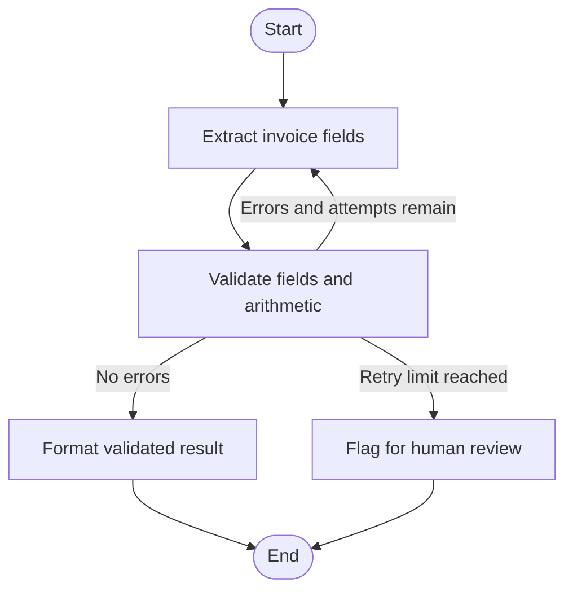

# Invoice Agent

A small LangGraph workflow that extracts invoice fields from text, validates the result deterministically, and retries extraction when validation fails. If the retry limit is reached, it flags the invoice for human review instead of guessing or silently correcting the supplier's figures.

## Flow



## Project structure

- `studio/graph.py` — extraction and graph workflow
- `studio/schemas.py` — structured invoice and result schemas
- `studio/validation.py` — deterministic validation and routing
- `studio/agent.py` — LangGraph Studio entry point
- `samples/` — sample invoice text
- `tests/` — schema, validation, routing, and graph tests

## Setup and run

Requires Python 3.12, `uv`, and an OpenAI API key.

```bash
uv sync
```

Create `studio/.env` using `studio/.env.example` as a template, and set `OPENAI_API_KEY`.

Run a sample from the project root:

```bash
uv run python -m studio.main samples/01_clean.txt
```

Run the tests:

```bash
uv run pytest
```

Launch LangGraph development mode:

```bash
uv run langgraph dev --config studio/langgraph.json
```

## Current scope

The project handles one invoice at a time. Validation errors trigger bounded retries; exhausted retries produce `needs_review` with the errors retained. See [`LATER.md`](LATER.md) for deferred work.
